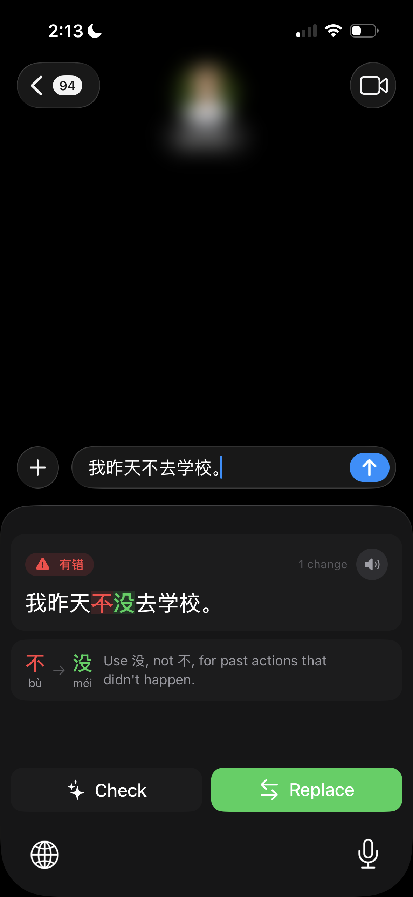
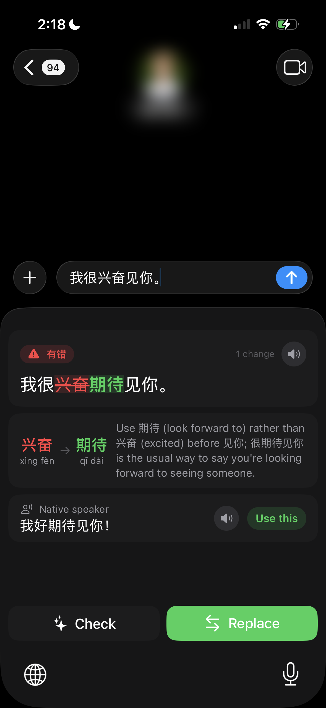
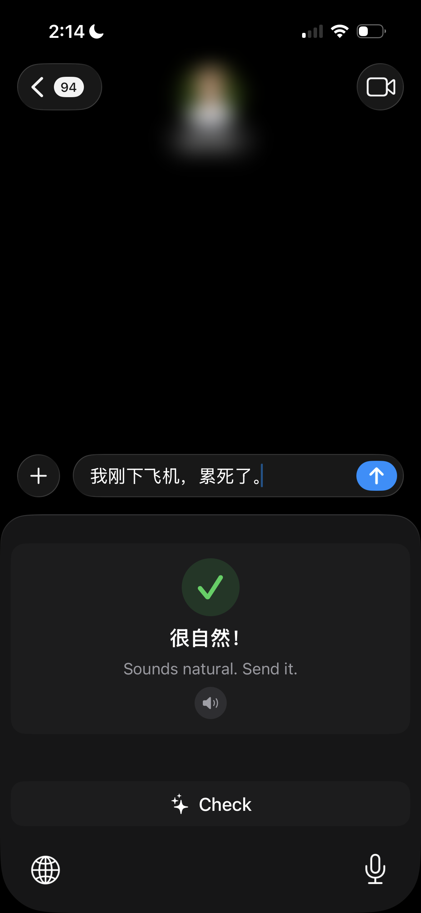
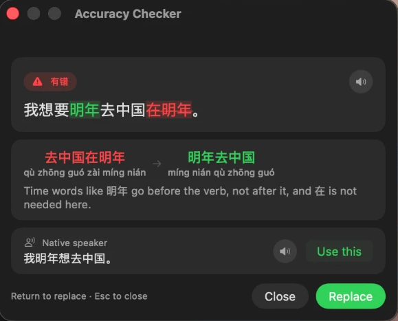

# AccuracyKeyboard

**An iPhone keyboard and Mac app that check my Mandarin text messages before I send them.**

I'm learning Mandarin (3rd-year university Chinese plus a summer in Beijing). My texts were usually understandable but often 不太自然 ("not quite natural"), and nobody corrects you mid-conversation. So I built a tool that does: type a message, tap **Check**, and see exactly what a native speaker would change, as tracked changes with pinyin and a short reason, while keeping as many of my own words as possible.

<table>
  <tr>
    <td align="center"></td>
    <td align="center"></td>
    <td align="center"></td>
  </tr>
  <tr>
    <td align="center"><sub><b>A mistake</b>: 不 → 没, with pinyin and why</sub></td>
    <td align="center"><sub><b>A word choice</b>: 兴奋 → 期待, plus how a native speaker would say it</sub></td>
    <td align="center"><sub><b>Already natural</b>: it stays quiet</sub></td>
  </tr>
</table>

<p align="center">
  <br>
  <sub><b>Mac</b>: press ⌃⌥C in any app. Here it fixes word order (time words go before the verb).</sub>
</p>

## What it does

- **Three verdicts:** ✓ natural (no changes), 不太自然 (small fix), 有错 (real mistake)
- **Tracked changes:** deletions in red strikethrough, additions in green, on a character-level diff
- **Each change explained:** `不 (bù) → 没 (méi)`: *Use 没, not 不, for things that didn't happen in the past.*
- **Replace / Undo:** swap the fix into the message box, or put the original back
- **Native version:** how a native speaker might phrase it, with a "Use this" button
- **Listen:** speaker buttons read the sentence aloud with the built-in Mandarin voice

### iPhone: custom keyboard
Type with Apple's Chinese keyboard as usual, tap 🌐 to switch to AccuracyKeyboard, tap **Check**. Works inside iMessage, WeChat, or any app with a text field.

### Mac: Accuracy Checker
Press **⌃⌥C** in any app's message box. A floating window shows the result; **Return** replaces the message, **Esc** closes. Also available from right-click › Services.

## How it works

```
message ──► Claude API (claude-haiku-5-5, structured JSON output)
                │  { verdict, corrected, changes[{from, to, reason}], native_version }
                ▼
        Swift character diff (original vs corrected) ──► red/green view + pinyin
```

Design decisions I made along the way:

- **The diff is computed in Swift, not by the model.** The model only returns the corrected sentence and reasons; the red/green view comes from Swift's `difference(from:)`, so what you see always matches what Replace inserts.
- **Staying quiet beats over-correcting.** The prompt prioritizes leaving natural messages alone, and a guardrail treats "natural" or "corrected == original" as ✓ no matter what else the model returns. My test set tracks *false alarms* (natural messages that got changed) separately from missed mistakes.
- **Minimal edits at my level.** Corrections keep my words and grammar level; more idiomatic phrasing goes in the separate "native version".
- **Structured outputs instead of forced tool use**, so the same code works across models.
- **One shared core, two apps.** The Mac app links to the iPhone keyboard's prompt, API client, result model and diff (symlinks), so prompt or model changes apply to both. Only the UI is platform-specific.
- **Privacy:** the API is only called when I tap Check or press the shortcut, never automatically.

### Testing the prompt
`check.py` runs the exact same prompt and JSON schema against a labeled test set (`tests.txt`, each line `message | natural` or `message | fix`) and writes an HTML report with the red/green view. I used it to tune the prompt and to choose the model and effort level (Haiku at medium effort: 19/19 on the test set, about 2 s per natural message).

```bash
python3 check.py --file tests.txt                 # run the test set
python3 check.py "我昨天不去学校"                   # check one message
python3 check.py --file tests.txt --model claude-sonnet-5-5
```

## Built with

Swift · SwiftUI · iOS custom keyboard extension (`UIInputViewController`) · AppKit (global hotkey, Services, Accessibility) · Swift Package Manager · Claude API · Python

## Project layout

| Path | What it is |
|---|---|
| `Keyboard/` | iPhone keyboard extension: UI (`CheckView.swift`), controller, and the shared core |
| `Keyboard/prompt.md` | The system prompt, used by the keyboard, the Mac app and `check.py` |
| `Keyboard/ClaudeClient.swift` | The API call and JSON schema |
| `Keyboard/Diff.swift` | Character diff and pinyin |
| `Mac/` | Accuracy Checker (macOS), built with SwiftPM via `Mac/build.sh` |
| `check.py`, `tests.txt` | Prompt test harness and labeled test set |

## Running it yourself

You need a Mac with Xcode, an iPhone, and a [Claude API key](https://console.anthropic.com).

1. `cp Secrets.swift.example Keyboard/Secrets.swift` and paste your API key (the file is gitignored).
2. **iPhone:** open `AccuracyKeyboard.xcodeproj`, select your team and device, press ▶. Then Settings › General › Keyboard › Keyboards › Add **AccuracyKeyboard** and turn on **Allow Full Access** (needed to reach the API).
3. **Mac:** `./Mac/build.sh`, then allow **Accuracy Checker** in System Settings › Privacy & Security › Accessibility.

The API key is compiled into the app, which is fine for personal use only. Shipping this to other people would need a small backend to hold the key.

## Roadmap

- Type pinyin directly in the keyboard so checks can happen without switching keyboards
- A journal of my most common mistakes
- Hebrew support

---

Built with help from [Claude Code](https://claude.com/claude-code).
